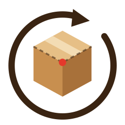

# Recrease

**Give old cardboard a second life.** Recrease is a browser app (one HTML file) that generates SVG files for laser-cutting boxes, built around reusing flattened boxes (e.g. HelloFresh) as cardboard – including reusing their existing crease lines.

**Gi gammel papp nytt liv.** Recrease er en nettleserapp (én HTML-fil) som lager SVG-filer til laserkutting av esker, bygget rundt å bruke utbrettede esker (f.eks. HelloFresh) som papp – også med gjenbruk av eksisterende brettelinjer.

## Use / Bruk

Open `index.html` in a browser. No install, works offline. Switch language with the NO / EN button (the browser language is used by default).

Åpne `index.html` i en nettleser. Ingen installasjon, virker uten internett. Bytt språk med NO / EN-knappen.

## Features

- Box with separate lid, one-piece box (HelloFresh style) and insert/padding
- Text on the lid, with separate layers for engrave, score and cut
- Sheet planner for a flattened box, including cut-off edges and reuse of existing creases
- Suggested laser settings (a starting point – always test on a scrap piece)
- Saved boxes in the browser, with export and import

## Files

- `index.html` – the whole app
- `assets/logo.svg` – the Recrease logo
